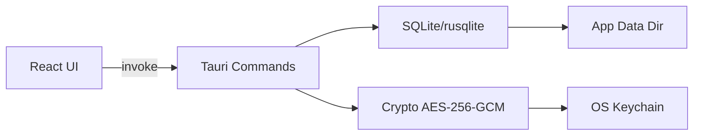

# Architecture

> Skeleton - to be finalized in step 9.

## Overview

EnvVault is a local-first Tauri 2 desktop app for managing `.env` files in an encrypted SQLite vault.

- **Frontend:** React + TypeScript + Vite, Tailwind + shadcn/ui.
- **Backend:** Rust (Tauri commands), owning all crypto and DB access.
- **Storage:** SQLite in OS app-data dir.
- **Secrets:** AES-256-GCM per value; master key in OS keychain.

## Planned Rust modules

- `db` - migrations, queries, SQLite access.
- `crypto` - AES-256-GCM encrypt/decrypt, nonce generation, zeroize.
- `keychain` - OS keychain trait + real/fake implementations.
- `parser` - `.env` parse/preview.
- `commands` - Tauri command handlers.
- `models` - shared data types.
- `error` - typed error enum (`thiserror`).

## Data flow

## Key lifecycle

To be documented in step 2.

## Tauri commands

To be documented as commands are added.
