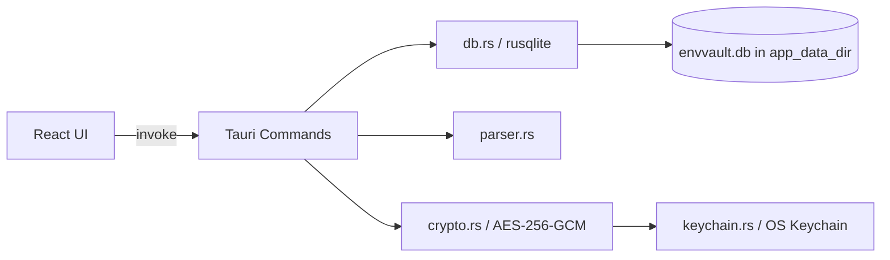

# Architecture

## Overview

EnvVault is a local-first Tauri 2 desktop app. The Rust backend owns all SQLite access, crypto, and OS keychain access. The React frontend only calls Tauri commands and never receives the master key.

## Module overview

### Frontend (`src/`)
- `src/App.tsx` - app shell, init/error handling, selection state, header actions.
- `src/components/layout/sidebar.tsx` - project/environment tree and management dialogs.
- `src/components/variables/variable-editor.tsx` - variable table, inline edit, reveal/copy/reorder/delete.
- `src/components/variables/import-dialog.tsx` - paste `.env`, preview, import.
- `src/components/ui/*` - square/border-based UI primitives.
- `src/hooks/*` - TanStack Query hooks for init/projects/environments/variables.
- `src/lib/api.ts` - typed `invoke` wrappers.
- `src/lib/types.ts` - frontend DTO types.
- `src/index.css` - Tailwind v4 theme tokens, `--radius: 0rem`, dark/light variables.

### Rust backend (`src-tauri/src/`)
- `lib.rs` - Tauri setup, app data DB init, master key bootstrap, command registration.
- `commands.rs` - Tauri command handlers and `AppState`.
- `db.rs` - SQLite open/init, migrations, CRUD queries.
- `crypto.rs` - AES-256-GCM encrypt/decrypt, key generation, key hex encode/decode.
- `keychain.rs` - `Keychain` trait, OS keychain impl, mock keychain for tests.
- `parser.rs` - `.env` parser/serializer and diagnostics.
- `models.rs` - Rust DTO/domain structs.
- `error.rs` - typed `AppError`/`AppResult`, UI-safe serialization.

## Data flow



## Data model (SQLite)

```sql
projects     (id TEXT PK, name TEXT UNIQUE, created_at, updated_at)
environments (id TEXT PK, project_id FK ON DELETE CASCADE, name TEXT, created_at, updated_at, UNIQUE(project_id, name))
variables    (id TEXT PK, environment_id FK ON DELETE CASCADE, key TEXT,
              value_encrypted BLOB, nonce BLOB, comment TEXT NULL, position INTEGER,
              created_at, updated_at, UNIQUE(environment_id, key))
meta         (key TEXT PK, value TEXT)
```

- Only `value_encrypted` contains secret value ciphertext. Keys/names/comments/positions remain plaintext for listing/search/order.
- Migrations are versioned through `meta.schema_version`.

## Key lifecycle

1. **Startup:** `lib.rs` resolves `app_data_dir`, opens/initializes `envvault.db`.
2. **Key lookup:** `OsKeychain` reads master key from service `envvault`, account `master-key`.
3. **First launch (no encrypted data):** generate random 32-byte key, store hex in OS keychain, keep key in memory (`Zeroizing`).
4. **Existing encrypted data:** if key is missing/unavailable, set init error and **do not** generate a new key. UI shows vault initialization error.
5. **Runtime use:** commands decrypt values only for explicit reveal/copy/export/import-related flows like reveal, copy, and import preview. List commands return masked placeholders.
6. **Memory:** key/value plaintext is kept only as needed; key is wrapped in `Zeroizing`.

**Dev/prod isolation:** debug builds (`pnpm tauri dev`) use `app_data_dir/dev/envvault.db` and keychain service `envvault-dev`; release builds use `app_data_dir/envvault.db` and service `envvault`. This prevents dev testing from touching the installed app vault.

## Tauri commands

| Command | Purpose |
|---|---|
| `get_init_status` | Return init error, if any |
| `list_projects` | List projects with environment/variable counts |
| `create_project` | Create project |
| `rename_project` | Rename project |
| `delete_project` | Delete project (cascade envs/vars) |
| `list_environments` | List environments for project |
| `create_environment` | Create environment |
| `rename_environment` | Rename environment |
| `delete_environment` | Delete environment (cascade vars) |
| `duplicate_environment` | Duplicate environment and encrypted variables |
| `list_variables` | List masked variable rows |
| `create_variable` | Encrypt and create variable |
| `update_variable` | Update key/comment and optionally re-encrypt value |
| `delete_variable` | Delete variable |
| `reorder_variables` | Update variable positions |
| `reveal_variable` | Decrypt and return a single variable value |
| `preview_env_import` | Parse `.env` text and return masked preview/status rows |
| `import_env_text` | Parse/encrypt/import `.env` text transactionally |
| `export_env_text` | Decrypt and serialize environment as `.env` text |

## Security boundaries

- Frontend never receives master key.
- Decrypted values cross boundary only for explicit reveal/copy/import-preview verification.
- Tauri capabilities are minimal (clipboard read/write, dialog save). No broad fs scope.
- Strict CSP; no remote scripts/network calls.
